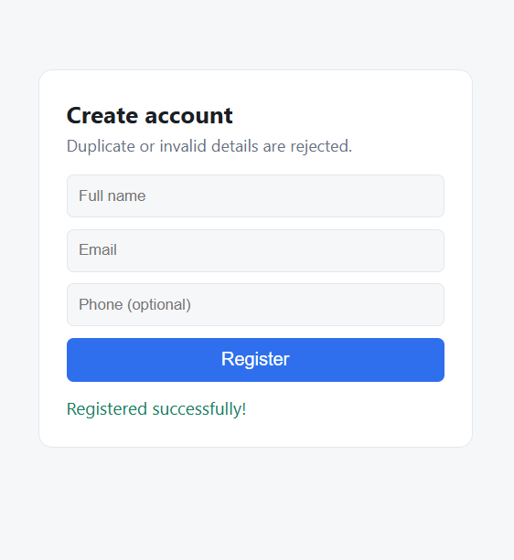
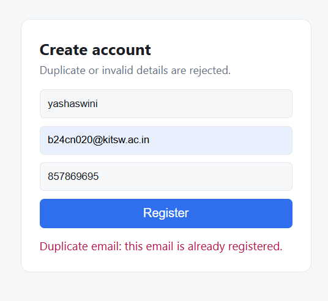

# CodeAlpha_DataRedundancySystem

A cloud-based **Data Redundancy Removal System** built for the CodeAlpha Cloud Computing Internship (Task 1).

## Overview
Duplicate and invalid data lowers the accuracy and efficiency of a database. This system checks every new registration against existing data and only stores entries that are valid and unique. Anything else is rejected with a clear message.

## Features
- Validates input: required fields, email format and numeric phone number
- Detects **exact duplicates** by email (database UNIQUE constraint and SHA-256 record hash)
- Detects **near duplicates** using fuzzy name matching (RapidFuzz) combined with the phone number
- Appends only unique, verified records to the database
- Shows clear messages, for example "Duplicate email: this email is already registered."
- Simple web interface and REST API
- Deployable on AWS EC2

## Tech Stack
Python, Flask, SQLite, RapidFuzz, email-validator, Gunicorn, HTML/CSS/JavaScript, AWS EC2

## How It Works
1. The user submits name, email and phone.
2. The input is validated.
3. The email is checked against existing records.
4. The phone and name are checked for near duplicates.
5. If everything passes, the record is saved. Otherwise it is rejected with a message.

## Live Demo
http://http://54.66.2.72/ *(add after deployment)*

## Screenshots

